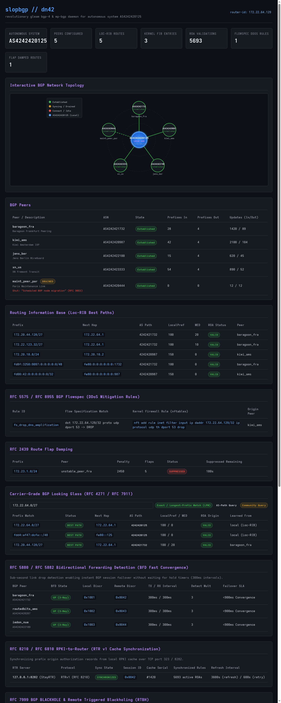

# slopbgp

> **slopbgp**: A revolutionary BGP-4 & MP-BGP routing daemon engineered in [Gleam](https://gleam.run) on the Erlang/OTP BEAM for [DN42](https://dn42.eu) and modern autonomous systems.

[](LICENSE)
[](https://gleam.run)
[](flake.nix)

---

## Why a BGP Daemon in Gleam?

In traditional C/C++ routing software (BIRD, FRRouting, OpenBGPD), a single malformed packet, buffer overflow, or memory corruption can panic or crash the entire routing daemon—tearing down dozens of BGP sessions, flushing host routing tables, and isolating an entire autonomous system.

**slopbgp** leverages the **Erlang BEAM Virtual Machine** and Gleam's modern type system:

1. **Actor-Per-Peer Fault Isolation**: Every BGP peering session runs as an independent OTP process with its own garbage-collected heap. If an upstream peer sends invalid data or misbehaves, only that peer's state machine resets; the RIB, FIB, and all other peers run uninterrupted.
2. **Zero-Copy Binary Pattern Matching**: BGP packet framing, attributes, and NLRIs are parsed using Erlang's battle-tested binary pattern matching—the world's fastest, memory-safe protocol parsing engine.
3. **No Stop-the-World GC Spikes**: Per-process heaps ensure that handling 100,000+ paths in the RIB never introduces jitter or latency spikes into active TCP sessions.
4. **Hermetic Nix Packaging**: Built with an offline, sandboxed Nix derivation with committed dependencies, development shells, checks, and a reusable NixOS module.

---

## Implemented RFCs & Protocol Extensions

`slopbgp` implements the full modern BGP protocol suite and extensions:

| RFC | Description | Support |
| :--- | :--- | :---: |
| **RFC 4271** | A Border Gateway Protocol 4 (BGP-4: Header, OPEN, UPDATE, NOTIFICATION, KEEPALIVE, FSM 6-states) | Full |
| **RFC 5492** | Capabilities Advertisement with BGP-4 | Full |
| **RFC 6793** | BGP Support for 4-Octet AS Numbers (32-bit ASNs for DN42 AS424242xxxx) | Full |
| **RFC 4760** | Multiprotocol Extensions for BGP-4 (MP-BGP: IPv4 & IPv6 Unicast) | Full |
| **RFC 8950** | Advertising IPv4 NLRI with an IPv6 Next Hop (Extended Next Hop Encoding) | Full |
| **RFC 2918** | Route Refresh Capability for BGP-4 | Full |
| **RFC 7313** | Enhanced Route Refresh (BoRR / EoRR demarcation) | Full |
| **RFC 7911** | Advertisement of Multiple Paths in BGP (ADD-PATH) | Full |
| **RFC 4724** | Graceful Restart Mechanism for BGP | Full |
| **RFC 8654** | Extended Message Support for BGP (up to 65,535 bytes) | Full |
| **RFC 1997** | BGP Communities Attribute (`NO_EXPORT`, `NO_ADVERTISE`) | Full |
| **RFC 4360** | BGP Extended Communities Attribute | Full |
| **RFC 8092** | BGP Large Communities Attribute (`asn:data1:data2`) | Full |
| **RFC 6811** | BGP Prefix Origin Validation (ROA Route Origin Authorization) | Full |
| **RFC 9234** | Route Leak Prevention and Detection (BGP Roles & OTC Attribute) | Full |
| **RFC 7606** | Revised Error Handling for BGP UPDATE Messages (treat-as-withdraw) | Full |
| **RFC 2439** | BGP Route Flap Damping (exponential decay, suppression & reuse thresholds) | Full |
| **RFC 8326** | Graceful BGP Session Shutdown (well-known community `65535:0` / `GRACEFUL_SHUTDOWN`) | Full |
| **RFC 9003** | Extended BGP Administrative Shutdown Communication (UTF-8 reason in NOTIFICATION Cease) | Full |
| **RFC 5575 / 8955** | Dissemination of Flow Specification Rules (BGP Flowspec IPv4 & nftables compilation) | Full |
| **RFC 8956** | Dissemination of Flow Specification Rules for IPv6 (Next Header, Flow Label, offset encoding) | Full |
| **RFC 7854** | BGP Monitoring Protocol (BMP v3: Route Monitoring, Stats, Peer Up/Down, Initiation TLVs) | Full |
| **RFC 7947 / 7948** | Internet Exchange Point (IXP) Route Server (Transparent AS_PATH, NEXT_HOP & Community Matrix) | Full |
| **RFC 4456** | BGP Route Reflection (ORIGINATOR_ID, CLUSTER_LIST loop prevention & reflection rules) | Full |
| **RFC 5065** | Autonomous System Confederations for BGP (AS_CONFED_SEQUENCE, AS_CONFED_SET & boundary stripping) | Full |
| **RFC 8212** | Default External BGP (eBGP) Route Propagation Behavior without Policies (Default-Deny) | Full |
| **RFC 8210 / 6810** | The RPKI to Router Protocol (RTR v0 & v1: PDU framing, cache synchronization & serial tracking) | Full |
| **RFC 5880 / 5882** | Bidirectional Forwarding Detection (BFD for BGP: 3-way handshake, 300ms intervals, sub-second failover) | Full |
| **RFC 7999** | BGP BLACKHOLE Community & Remote Triggered Blackholing (RTBH DDoS mitigation & kernel discard) | Full |
| **RFC 7432 / 8365** | BGP MPLS-Based Ethernet VPN (EVPN Type 2 MAC/IP, Type 5 IP Prefix & RFC 9012 VXLAN Encap) | Full |
| **RFC 4364 / 4659** | BGP/MPLS IP Virtual Private Networks (L3VPN Multi-VRF Isolation, RD Type 0/1/2 & Route Targets) | Full |
| **RFC 8669** | BGP Prefix-SID for Segment Routing (Path Attribute 40, Label-Index, IPv6 SRv6 SID & SRGB) | Full |
| **RFC 5549 / 8950** | BGP Unnumbered (IPv6 Link-Local Peering with Extended Next-Hop & Linux inet6 kernel routing) | Full |
| **RFC 7752** | Distribution of BGP Link-State (BGP-LS: Node NLRIs, Link NLRIs & Attribute 29 TLVs) | Full |
| **RFC 7938 / 7454** | BGP Route Hygiene & Security (Martian ASNs, RFC 6890 Bogons, Path Bounds & Prepending Limits) | Full |
| **RFC 8538** | BGP Long-Lived Graceful Restart (LLGR Capability 71, LLGR_STALE & NO_LLGR Communities) | Full |
| **RFC 7938** | Use of BGP for Routing in Large-Scale Data Centers (Equal-Cost Multi-Path ECMP & UCMP Weighted Bandwidth) | Full |
| **RFC 8205** | BGPsec Path Signatures & AS-Path Cryptographic Security (ECDSA P-256 Signatures & Target AS Chaining) | Full |
| **RFC 9072** | Extended Optional Parameters Length for BGP OPEN Messages (up to 65,535 bytes) | Full |
| **RFC 8416** | Simplified Local Internet Number Resource Management with the RPKI (SLURM Local Exceptions) | Full |
| **RFC 4684** | Constrained Route Distribution for BGP/MPLS IP VPNs (Route Target Constraint - RTC) | Full |
| **RFC 9107** | BGP Optimal Route Reflection (BGP-ORR: Perspective-Based Client Best-Path & Deflection Avoidance) | Full |
| **BGP-PIC** | BGP Prefix-Independent Convergence (BGP-PIC Edge/Core & Sub-Millisecond O(1) Fast Reroute) | Full |

---

## DN42 Intelligence

`slopbgp` comes with first-class DN42 optimizations:

* **Live ROA Registry Validation**: Directly parses and validates against BIRD or JSON format ROA tables (`/etc/bird/roa_dn42.conf` and `roa_dn42_v6.conf`). Evaluates routes into `VALID`, `INVALID`, or `NOT_FOUND` following RFC 6811.
* **Bogon & Martian Filters**: Automatically enforces valid DN42 prefix boundaries (`172.20.0.0/14` /21–/29, Anycast /28–/32, `172.31.0.0/16`, `10.100.0.0/14`, `10.127.0.0/16`, `10.0.0.0/8{15,24}`, and IPv6 `fd00::/8{44,64}`).
* **DN42 Community Automations**:
  * Latency metrics: `(64511, 1..9)`
  * Bandwidth categories: `(64511, 21..29)`
  * Encryption tagging: WireGuard `(64511, 34)`
  * Region codes: Europe `(64511, 41)`, North America `(64511, 42)`, etc.
* **Extended Next Hop over WireGuard**: Transmits IPv4 unicast reachability with IPv6 link-local next hops (`fe80::...`) over point-to-point tunnels without requiring IPv4 transit configuration.

---

## Routing Information Base (Loc-RIB)

The decision engine chooses the best path using a 10-stage tie-breaking algorithm:

1. **ROA Validation**: `VALID` beats `NOT_FOUND`, both beat `INVALID` (RFC 6811).
2. **Local Preference**: Highest `local_pref` (default 100).
3. **AS_PATH Length**: Shortest path (counting `AS_SEQUENCE` and `AS_SET`; confederation segments excluded per RFC 5065).
4. **Origin**: `IGP` (0) < `EGP` (1) < `INCOMPLETE` (2).
5. **MED**: Lowest Multi-Exit Discriminator when from the same neighbor AS.
6. **Peering Type**: Prefer eBGP over iBGP.
7. **DN42 Latency Metric**: Prefer lower latency community (`64511:1` over `64511:9`).
8. **Route Reflection CLUSTER_LIST**: Shorter `CLUSTER_LIST` length preferred (RFC 4456).
9. **ORIGINATOR_ID / Router ID**: Lowest `ORIGINATOR_ID` or BGP Identifier (RFC 4456).
10. **Tie-Breaker**: Lowest peer identifier / earliest timestamp.

---

## Policy Engine & DN42 Filters

`slopbgp` features a composable, deterministic routing policy rule engine:

* **Policy Matchers**: Prefix filters (exact or subnet match), AS-Path regex/contains, AS-Path origin AS, AS-Path length limits, standard Communities, RFC 8092 Large Communities, and RFC 6811 ROA validation states (`VALID`, `INVALID`, `NOT_FOUND`).
* **Policy Actions**: `Accept`, `Reject`, `SetLocalPref(int)`, `SetMed(int)`, `PrependAs(asn, count)`, `AddCommunity(c)`, `RemoveCommunity(c)`, and `SetNextHop(ip)`.
* **DN42 Default Import/Export Chains**: Pre-configured with bogon drop rules, martian filtering, ROA enforcement, and DN42 community rewriting out-of-the-box.

---

## BGP Flowspec (RFC 5575 / RFC 8955) & nftables

Protect your autonomous system and peering links from denial-of-service floods:

* **Flowspec Component Dissemination**: Full binary parser and encoder for Type 1 (Destination Prefix), Type 2 (Source Prefix), Type 3 (IP Protocol: TCP, UDP, ICMP), Type 4 (Port), Type 5 (Destination Port), Type 6 (Source Port), Type 7 (ICMP Type), Type 8 (ICMP Code), Type 9 (TCP Flags: SYN, ACK, FIN, RST), Type 10 (Packet Length), and Type 11 (DSCP).
* **Flowspec Actions**: Extended communities for Traffic-Rate (`0x8006`, drop or rate-limit bytes/sec), Traffic-Action (`0x8007`, sample & terminal), Redirect (`0x8008`), and Traffic-Marking (`0x8009`, DSCP re-marking).
* **nftables Compilation**: Directly compiles BGP Flowspec rules into kernel `nftables` syntax (`nft add rule inet slopbgp ddos_filter ... drop`) for wire-speed line-rate packet discarding.

---

## RFC 2439 Route Flap Damping

Prevent unstable upstream links or oscillating routes from overwhelming CPU and forwarding tables:

* **Mathematical Half-Life Decay**: Calculates real-time exponential penalty decay:
  $$P(t) = P_0 \cdot \left(\frac{1}{2}\right)^{\frac{\Delta t}{\tau}}$$
* **Suppression & Reuse Thresholds**: Routes exceeding the cut-off penalty (default 2000) are automatically suppressed from Loc-RIB and FIB installation. Once the penalty decays below the reuse threshold (default 750), the route is unsuppressed.
* **Bounded Suppression**: Hard ceiling on maximum suppression duration (default 3600 seconds) prevents permanent route blackholing.

---

## RFC 8326 Graceful BGP Session Shutdown

Perform hitless, zero-packet-loss maintenance on routers and peering links:

* **Well-Known Community**: Attaches `65535:0` (`GRACEFUL_SHUTDOWN`) on outbound UPDATE messages before link teardown.
* **Inbound Local Preference Depressing**: Upon receiving routes with the graceful shutdown community, `slopbgp` automatically lowers `local_pref` to 0, shifting transit traffic away to alternate paths before TCP teardown.
* **Dynamic Operator Drain**: Drain and restore individual peers dynamically via `slopbgpctl drain <peer_ip>` and `slopbgpctl undrain <peer_ip>`.

---

## Built-In Web Dashboard & JSON REST API

`slopbgp` includes a built-in reactive HTTP server (default `http://127.0.0.1:9179`):

* **Interactive Dark-Mode Dashboard**: Visual cards for AS number, active sessions, prefix counts, kernel FIB entries, ROA rules, active Flowspec filters, and suppressed damped routes.
* **Live Peers Table**: Real-time FSM states (Established, OpenConfirm, Connect), prefix counters, keepalives, and uptime.
* **Loc-RIB Table**: Searchable route table showing prefixes, next hops, AS paths, local prefs, and ROA validation badges.
* **DDoS Flowspec & Damping Views**: Dedicated inspection cards for active DDoS mitigation rules and route flap suppression timers.
* **Prometheus Metrics Exporter**: Native `/metrics` endpoint exposing OpenMetrics/Prometheus counters and gauges for Grafana dashboards.
* **REST API**:
  * `GET /api/status`: JSON daemon summary
  * `GET /api/peers`: JSON peer status list
  * `GET /api/routes`: JSON active best routes
  * `GET /api/fib`: JSON kernel forwarding table entries
  * `GET /api/flowspec`: JSON active Flowspec DDoS rules
  * `GET /api/damping`: JSON route flap damping history and suppressed paths
  * `GET /api/routeserver`: JSON RFC 7947 / RFC 7948 Route Server client matrix
  * `GET /api/bmp`: JSON RFC 7854 BGP Monitoring Protocol station feeds
  * `GET /metrics`: Prometheus metric exposition

---

## Operator CLI (`slopbgpctl`)

The bundled `slopbgpctl` utility allows instant inspection and operational control:

```bash
# Daemon status overview
slopbgpctl status

# Inspect active BGP peers
slopbgpctl peers

# Query Loc-RIB routing table
slopbgpctl routes
slopbgpctl routes 172.22.64

# Query Kernel FIB entries
slopbgpctl fib

# Inspect Route Flap Damping suppression table
slopbgpctl flap

# Inspect active BGP Flowspec DDoS mitigation rules (IPv4 & IPv6 RFC 8956)
slopbgpctl flowspec

# Gracefully drain / undrain a BGP peer session (RFC 8326 + RFC 9003)
slopbgpctl drain 172.22.64.130 "Link maintenance 08:00 UTC"
slopbgpctl undrain 172.22.64.130

# Administratively shut down session with RFC 9003 communication
slopbgpctl shutdown 172.22.64.130 "Decommissioning upstream peer"

# Dynamic hot-reload of daemon configuration without session drops
slopbgpctl reload

# Inspect RFC 7854 BMP monitoring feeds
slopbgpctl bmp

# Inspect RFC 7947/7948 IXP Route Server status & clients
slopbgpctl routeserver

# Inspect RFC 4456 Route Reflector status & clients
slopbgpctl rr

# Inspect RFC 5065 BGP Confederation status & member peers
slopbgpctl confed

# Render Autonomous Peering Topology Graph
slopbgpctl topology

# Export full Web Dashboard HTML with SVG topology
slopbgpctl dashboard /srv/http/dashboard.html

# Inspect configured routing policies
slopbgpctl policy

# Scrape live Prometheus metrics
slopbgpctl metrics

# Perform instantaneous RFC 6811 ROA origin validation
slopbgpctl roa check 172.22.64.128/27 4242420125
# Result: VALID (Origin AS4242420125 authorized)

slopbgpctl roa check 172.22.64.128/27 999999
# Result: INVALID (Origin AS999999 NOT authorized or exceeds max-length)

# Query Carrier Looking Glass (Route exact/LPM, AS-Path, Community, Summary)
slopbgpctl lg route 172.22.64.0/27
slopbgpctl lg aspath 4242421732
slopbgpctl lg community 65535:666
slopbgpctl lg summary

# Inspect RFC 8210 / RFC 6810 RPKI RTR cache synchronization
slopbgpctl rtr

# Inspect RFC 5880 / RFC 5882 BFD sessions and sub-second failover states
slopbgpctl bfd

# List and manage RFC 7999 RTBH DDoS sinkhole routes
slopbgpctl blackhole list
slopbgpctl blackhole add 172.22.64.42/32
slopbgpctl blackhole del 172.22.64.42/32

# Inspect RFC 7432 / RFC 8365 BGP EVPN fabric routes (Type 2 MAC & Type 5 Prefix)
slopbgpctl evpn

# Inspect RFC 4364 / RFC 4659 Multi-Tenant VRF Isolation & L3VPN
slopbgpctl vrf
slopbgpctl vrf routes tenant-red

# Inspect RFC 8669 BGP Prefix-SID for Segment Routing (SR-MPLS / SRv6)
slopbgpctl sr

# Inspect RFC 5549 / RFC 8950 BGP Unnumbered IPv6 Link-Local Peering
slopbgpctl unnumbered

# Global Network Model compiler, topology graphviz/mermaid exporter, and validator
slopbgpctl netmodel validate examples/slopnet_global.json
slopbgpctl netmodel compile examples/slopnet_global.json fra-core1
slopbgpctl netmodel graph examples/slopnet_global.json mermaid

# Run multi-router discrete topology simulation & route leak verification
slopbgpctl netmodel sim examples/slopnet_global.json

# Run network resilience, high-availability & SLA latency audit
slopbgpctl netmodel audit examples/slopnet_global.json

# Run what-if failure blast-radius simulation (disaster recovery & link severance)
slopbgpctl netmodel whatif examples/slopnet_global.json fail-node fra-core1
slopbgpctl netmodel whatif examples/slopnet_global.json fail-link wan_fra_nyc

# Inspect RFC 8538 Long-Lived Graceful Restart (LLGR) status
slopbgpctl llgr

# Inspect RFC 9319 ASPA verification & test AS paths
slopbgpctl aspa
slopbgpctl aspa verify 4242420003 4242421732 4242420001

# Inspect RFC 9234 BGP Roles & OTC route leak prevention
slopbgpctl otc

# Inspect RFC 7752 BGP-LS Link-State
slopbgpctl bgpls

# Preview GitOps fleet provisioning plan across all network routers
slopbgpctl netmodel plan examples/slopnet_global.json

# Detect GitOps fleet configuration drift against global network model
slopbgpctl netmodel drift examples/slopnet_global.json

# Inspect RFC 7938 ECMP & UCMP multipath FIB resolution
slopbgpctl ecmp

# Verify RFC 8205 BGPsec AS-Path cryptographic signatures
slopbgpctl bgpsec
slopbgpctl bgpsec verify 4242421732 4242420987 4242420125

# Step-by-step route policy trace & dry-run evaluation
slopbgpctl filter test 172.20.10.0/24 4242421732 64511:1

# Static analysis, shadowed rule detection & policy optimization
slopbgpctl filter audit

# Inspect SlopFilter policy pipeline & RFC 7938 route hygiene
slopbgpctl filter

# Evaluate route origin with RFC 8416 RPKI SLURM local assertions & filters
slopbgpctl slurm check 172.22.64.128/28 4242420125
slopbgpctl slurm validate slurm.json
slopbgpctl slurm

# Inspect RFC 4684 Route Target Constraint (RTC) subscriptions & outbound VPN filtering
slopbgpctl rtc table
slopbgpctl rtc filter baragoon_fra 4242420125:100
slopbgpctl rtc

# Calculate RFC 9107 BGP Optimal Route Reflection (BGP-ORR) client paths & audit deflection
slopbgpctl orr matrix
slopbgpctl orr bestpath slop_nyc1 172.20.1.0/24
slopbgpctl orr audit

# Inspect BGP Prefix-Independent Convergence (BGP-PIC) & simulate sub-millisecond fast failover
slopbgpctl pic routes
slopbgpctl pic failover 172.22.64.1
slopbgpctl pic status
```

---

## Web Dashboard & Interactive Network Topology

`slopbgp` includes a built-in cyberpunk HTTP/REST monitoring dashboard with an interactive SVG peering graph, Carrier Looking Glass panel, live Loc-RIB best routes, Kernel FIB tables, ROA validation counters, Flowspec DDoS rules, BFD fast-failover sessions, Flap damping decay, Multi-VRF Isolation, Segment Routing SIDs, BGP Unnumbered peer status, RFC 8416 SLURM overrides, RFC 4684 RTC subscriptions, RFC 9107 BGP-ORR client perspectives, and BGP-PIC fast reroute:



* **Real-time Radial SVG Peering Graph**: Visualizes local router hub with glowing session states (Established in green, Syncing/Drained in amber, Inactive in red/gray).
* **Carrier Looking Glass**: Live route queries with exact and longest-prefix match (LPM), AS-Path traversal inspection, and Community filters.
* **RFC Inspection**: Live endpoints for `/api/status`, `/api/peers`, `/api/routes`, `/api/topology`, `/api/rr`, `/api/confed`, `/api/flowspec`, `/api/damping`, `/api/routeserver`, `/api/bmp`, `/api/rtr`, `/api/slurm`, `/api/rtc`, `/api/orr`, `/api/pic`, `/api/bfd`, `/api/blackhole`, `/api/evpn`, `/api/lg`, `/api/vrf`, `/api/sr`, `/api/unnumbered`.
* **Zero External Dependencies**: Pure SVG and HTML rendered by the daemon without requiring node, webpack, or javascript bundles.

---

## Built-In Protocol Simulator

`slopbgp` includes a standalone multi-router protocol simulator that spins up virtual BGP speakers in-memory, exchanges OPENs, negotiates capabilities, streams UPDATEs, converges Loc-RIB, and verifies RFC compliance:

```bash
slopbgp sim
```

---

## Building & Running

### With Nix (Recommended)

```bash
# Build sandboxed package
nix build -L

# Run built binary
./result/bin/slopbgp --help
./result/bin/slopbgp sim
./result/bin/slopbgp ctl status

# Enter development shell
nix develop
```

### With Gleam

```bash
# Run unit and integration test suite (56 test suites passing)
gleam test

# Format code
gleam format

# Export standalone Erlang shipment
gleam export erlang-shipment
```

---

## NixOS Module

Exported via `nixosModules.default`:

```nix
services.slopbgp = {
  enable = true;
  asn = 4242420125;
  routerId = "172.22.64.129";
  bgpPort = 179;
  apiPort = 9179;
  configFile = "/etc/slopbgp/slopbgp.json";
};
```

---

## Source

Source: [https://github.com/slopinger/slopbgp](https://github.com/slopinger/slopbgp)

Licensed under the [MIT License](LICENSE).
